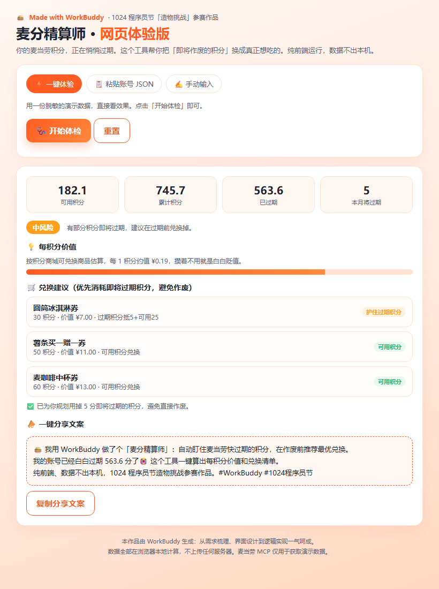

# 🍔 麦分精算师 · 网页体验版（Points Advisor Web）

> **WorkBuddy「1024 造物挑战」程序员节应用创作大赛 · 参赛作品**
> Made with WorkBuddy · 纯前端 · 单文件 · 零依赖 · 数据不出本机

你的麦当劳积分，正在悄悄过期。这个工具帮你把「即将作废的积分」换成真正想吃的。

## ✨ 它能做什么

- **积分体检**：一眼看清可用 / 累计 / 已过期 / 本月将过期，并给出风险等级（低 / 中 / 高）
- **每积分价值**：按积分商城可兑换商品估算每 1 积分的真实价值，让"攒着不用"的隐性贬值看得见
- **兑换建议**：贪心算法优先消耗即将过期积分，输出最优兑换清单，避免白白作废
- **一键分享文案**：生成带 `#WorkBuddy #1024程序员节` 话题的分享文案，复制即可发社媒

## 📸 界面预览

## 🚀 如何体验

单文件网页应用，无需安装、无需 Token：

1. 打开体验链接（见投稿信息）
2. 点击「⚡ 一键体验」→「🩺 开始体检」，用脱敏演示数据立刻看到完整报告
3. 也可以切到「📋 粘贴账号 JSON」或「✍️ 手动输入」用你自己的数据算

## 🧱 技术实现

- 单 `index.html`，内联 CSS/JS，无任何外部依赖与请求，可在断网环境运行
- 核心算法：按「积分价值 = 价格 / 所需积分」排序商品，贪心优先用即将过期积分抵扣，最大化保住快作废的积分
- 兼容多种账号 JSON 字段命名（`availablePoint` / `available` 等），贴合麦当劳 MCP 真实返回结构

## 🔒 隐私说明

所有计算均在浏览器本地完成，**不上传任何数据**；演示数据为脱敏样例。

## 🛠️ 用 WorkBuddy 怎么做的

从需求梳理、界面设计、核心算法到调试验证，全程在 WorkBuddy 中以对话完成：
WorkBuddy 生成了完整单文件应用，并自动用无头浏览器渲染验证（0 JS 报错）+ 生成参赛截图。

## 📄 License

MIT
